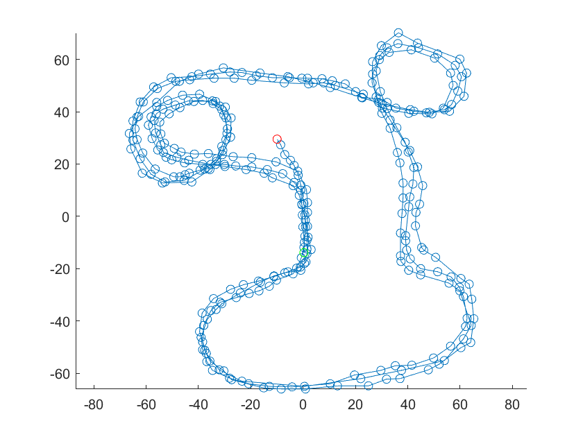
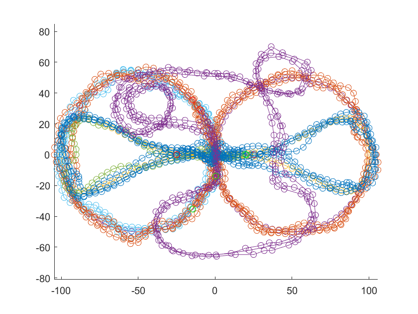
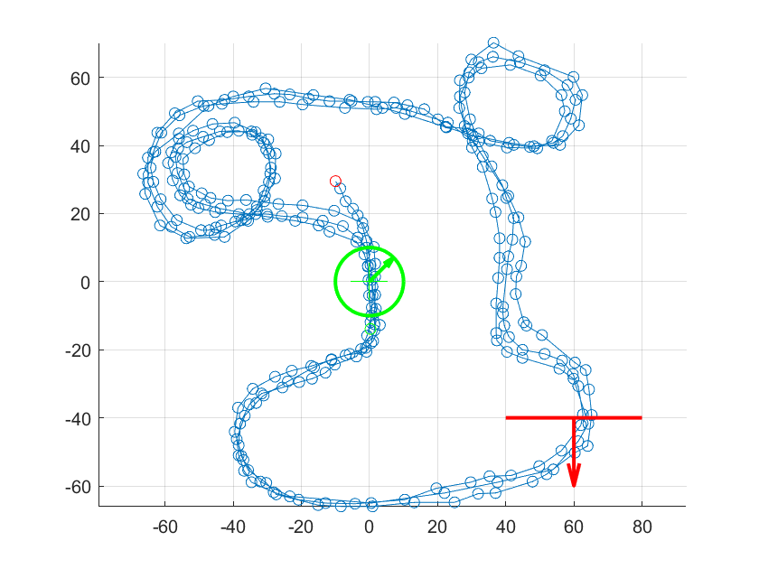
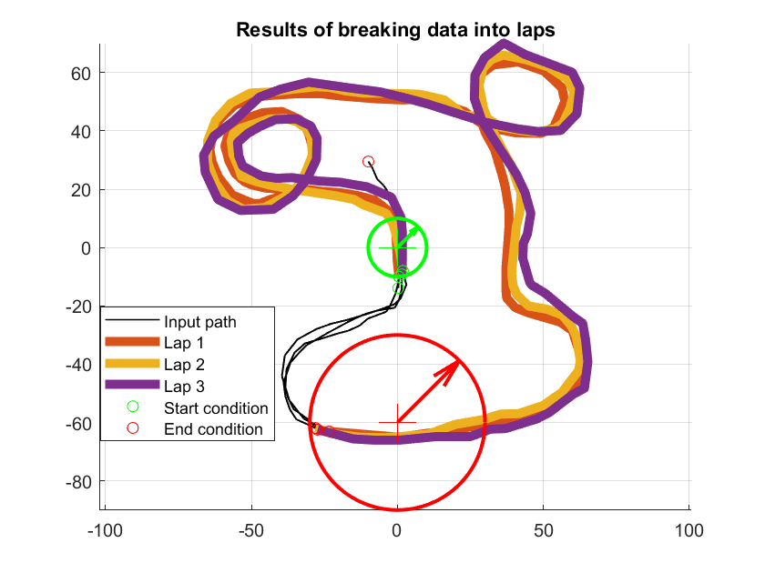
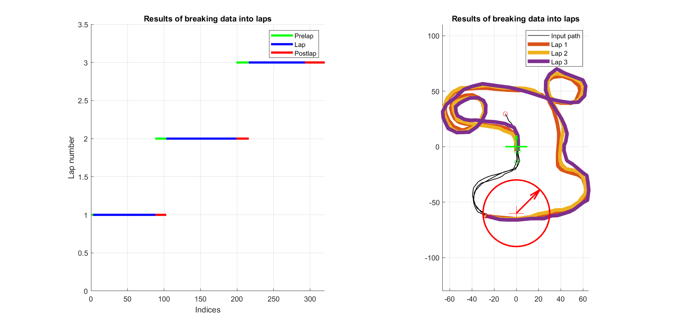
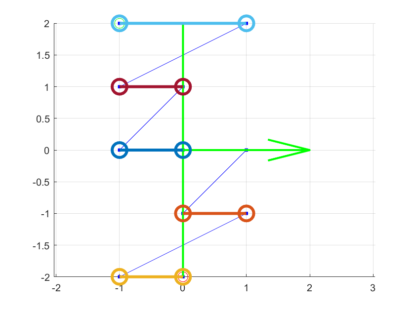
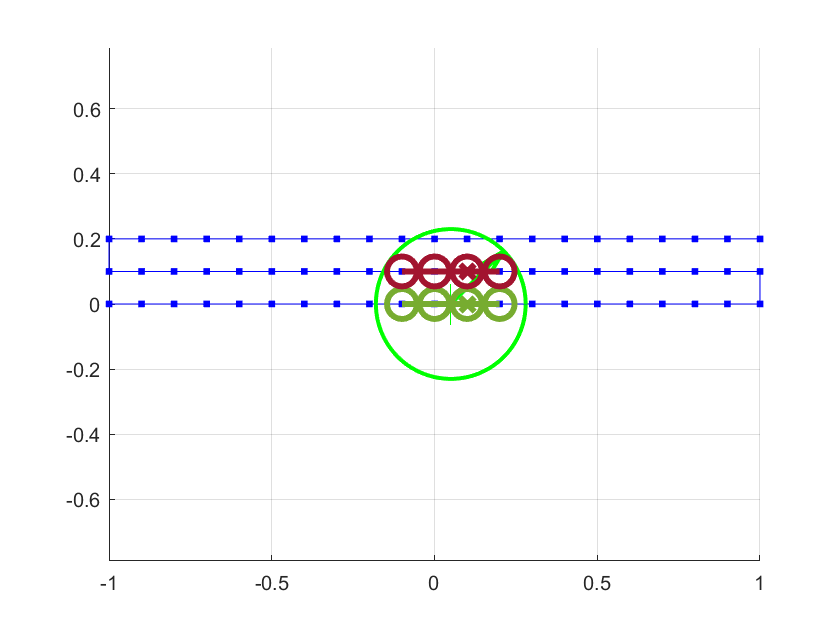
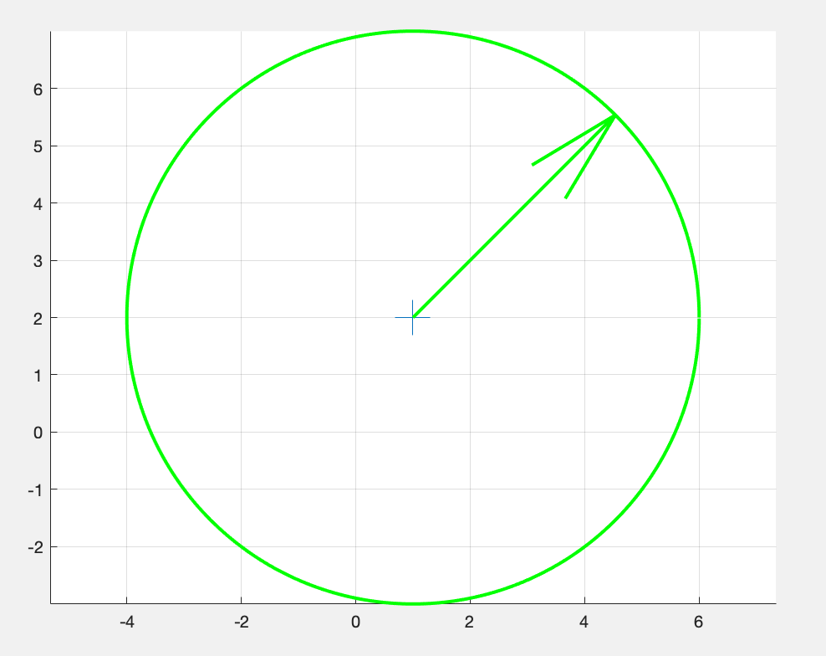
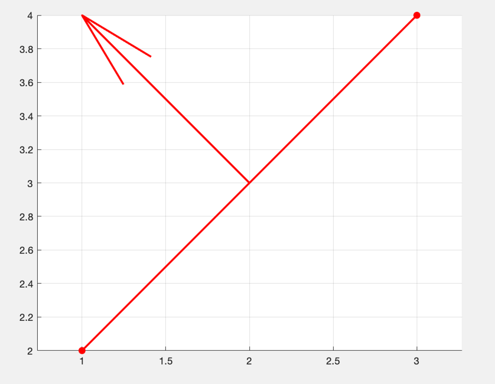

# FeatureExtraction_DataClean_BreakDataIntoLaps

<!--
The following template is based on:
Best-README-Template
Search for this, and you will find!
-->
<!-- PROJECT LOGO -->
<br />
<p align="center">

  <h2 align="center"> FeatureExtraction_DataClean_BreakDataIntoLaps
  </h2>

  <pre align="center">
    
    <!--font size="-2">Photo by <a href="https://unsplash.com/ko/@samuelchenard?utm_source=unsplash&utm_medium=referral&utm_content=creditCopyText">Samuel Chenard</a> on <a href="https://unsplash.com/photos/Bdc8uzY9EPw?utm_source=unsplash&utm_medium=referral&utm_content=creditCopyText">Unsplash</a></font -->
</pre>

  <p align="center">
    The purpose of this code is to break data into "laps", namely segments of data that are defined by a clear start condition and end condition. The code finds when a given path meets the "start" condition, then meets the "end" condition, and returns every portion of the path that is inside both conditions. Advanced features of the code include the ability to return the row indices defining each lap's data, as well as the path portions before and after the laps in case the "run in" or "run out" areas are needed.
    <br />
    <br />
    <a href="https://github.com/ivsg-psu/FeatureExtraction_DataClean_BreakDataIntoLaps/tree/main/Documents">View Documents</a>
    ·
    <a href="https://github.com/ivsg-psu/FeatureExtraction_DataClean_BreakDataIntoLaps/issues">Report Bug</a>
    ·
    <a href="https://github.com/ivsg-psu/FeatureExtraction_DataClean_BreakDataIntoLaps/issues">Request Feature</a>
  </p>
</p>

***

<!-- TABLE OF CONTENTS -->
<details open="open">
  <summary><h2 style="display: inline-block">Table of Contents</h2></summary>
  <ol>
    <li>
      <a href="#about-the-project">About the Project</a>
    </li>
    <li>
      <a href="#getting-started">Getting Started</a>
      <ul>
        <li><a href="#installation">Installation</a></li>
        <li><a href="#directories">Top-Level Directories</a></li>
        <li><a href="#dependencies">Dependencies</a></li>
      </ul>
    </li>
    <li><a href="#functions">Functions</a>
      <ul>
        <li><a href="#basic-support-functions">Basic Support Functions</a>
          <ul>
            <li><a href="#fcn_laps_plotlapsxy">fcn_Laps_plotLapsXY - Plotting utility for lap outputs</a></li>
            <li><a href="#fcn_laps_fillsamplelaps">fcn_Laps_fillSampleLaps - Creates test datasets</a></li>
            <li><a href="#fcn_laps_plotzonedefinition">fcn_Laps_plotZoneDefinition - Plots zone definitions of either type</a></li>
            <li><a href="#fcn_laps_plotpointzonedefinition">fcn_Laps_plotPointZoneDefinition - Plots a point zone</a></li>
            <li><a href="#fcn_laps_plotsegmentzonedefinition">fcn_Laps_plotSegmentZoneDefinition - Plots a segment zone</a></li>
          </ul>
        </li>
        <li><a href="#core-functions">Core Functions</a>
          <ul>
            <li><a href="#fcn_laps_breakdataintolaps">fcn_Laps_breakDataIntoLaps - Core function of the repo, breaks data into laps</a></li>
            <li><a href="#fcn_laps_checkzonetype">fcn_Laps_checkZoneType - Checks inputs to determine if zone is a point or line segment type</a></li>
            <li><a href="#fcn_laps_breakdataintolapindices">fcn_Laps_breakDataIntoLapIndices - Returns the indices that apply to each lap</a></li>
            <li><a href="#fcn_laps_findsegmentzonestartstop">fcn_Laps_findSegmentZoneStartStop - Finds the portions of a path that meet a segment zone criteria</a></li>
            <li><a href="#fcn_laps_findpointzonestartstopandminimum">fcn_Laps_findPointZoneStartStopAndMinimum - Finds the portions of a path that meet a point zone criteria</a></li>
          </ul>
        </li>
      </ul>
    </li>
    <li><a href="#usage">Usage</a>
      <ul>
        <li><a href="#general-usage">General Usage</a></li>
        <li><a href="#calling-convention-required-inputs-then-namevalue-options">Calling Convention</a></li>
        <li><a href="#examples">Examples</a></li>
        <li><a href="#definition-of-endpoints">Definition of Endpoints</a></li>
      </ul>
    </li>
    <li><a href="#license">License</a></li>
    <li><a href="#major-release-versions">Major Release Versions</a></li>
    <li><a href="#contact">Contact</a></li>
  </ol>
</details>

***

<!-- ABOUT THE PROJECT -->
## About The Project

The most common location of our testing is the Larson Test Track, and we regularly use "laps around the track" as replicates, hence the name of the library. And when not on the test track and on public roads, data often needs to be segmented from one keypoint to another. For example, it is a common task to seek a subset of path data that resides only from one intersection to the next. While one could segment this data during data collection by simply stopping the vehicle recordings at each segment, it is impractical and dangerous to stop data collection at each and every possible intersection or feature point. Rather, vehicle or robot data is often collected by repeated driving of an area over and over without stopping. So, the final data set may contain many replicates of the area of interest.

This "Laps" code assists in breaking recorded path data into paths by defining specific start and end locations, for example from intersection "A" to stop sign "B". Specifically, the purpose of this code is to break data into "laps", namely segments of data that are defined by a clear start condition and end condition. The code finds when a given path meets the "start" condition, then meets the "end" condition, and returns every portion of the path that is inside both conditions. There are many advanced features as well, including the ability to define excursion zones, the number of points that must be within a zone for it to activate, and the ability to extract the portions of the path before and after the laps, in addition to the data for each lap.

* Inputs:
  * a path, given as an N x 2 [X Y] or N x 3 [X Y Z] array of points. Laps are found using the X and Y columns only; all columns are kept in the outputs.
  * the start, end, and optional excursion zones, each given as either a point and radius or a line segment (see <a href="#definition-of-endpoints">Definition of Endpoints</a>).
* Outputs:
  * one array of points, or of row indices, for each lap
  * the points that are not part of any lap, namely the points before the first lap ("entry") and after the last lap ("exit"). If no laps are found, the entry is the whole path.

<a href="#featureextraction_dataclean_breakdataintolaps">Back to top</a>

***

<!-- GETTING STARTED -->
## Getting Started

To get a local copy up and running follow these simple steps.

### Installation

1. Make sure to run MATLAB R2025a or later. The code requires at least R2021a, because the functions use arguments blocks with Name=Value optional inputs (see <a href="#calling-convention-required-inputs-then-namevalue-options">Calling Convention</a>), and it is tested on 2025 releases.

2. Clone the repo

   ```sh
   git clone https://github.com/ivsg-psu/FeatureExtraction_DataClean_BreakDataIntoLaps
   ```

3. Run the main script in the root of the folder, script_demo_Laps.m. The first time it runs, it downloads the latest release of each required library from GitHub, unzips each into its own folder under ./Utilities, and adds those folders to the MATLAB path. The dependencies are no longer included in this repo, so an internet connection is needed for this first run. On later runs, or if the computer is offline, the libraries already in ./Utilities are used. To force a fresh install, delete the Utilities folder and run script_demo_Laps again.

4. Confirm it works! If the code works, script_demo_Laps should run without errors. This script produces numerous example images such as those in this README file.

<a href="#featureextraction_dataclean_breakdataintolaps">Back to top</a>

***

<!-- STRUCTURE OF THE REPO -->
### Directories

The following are the top level directories within the repository:
<ul>
 <li>/Data folder: Placeholder for data files used by the library (currently holds only a template README).</li>
 <li>/Documents folder: Descriptions of the functionality and usage of the various MATLAB functions and scripts in the repository, and the release checklist.</li>
 <li>/Functions folder: All functions of the Laps library, each with an associated test script.</li>
 <li>/Images folder: Images used in this README.</li>
 <li>/Installer folder: The installer function that script_demo_Laps uses to download and install the dependencies.</li>
 <li>/Releases folder: Zip files of early releases of this repo (2023). Current releases are on the repo's GitHub Releases page.</li>
 <li>/Utilities folder: Created by the installer on the first run of script_demo_Laps. Holds the dependencies, one folder per library, named by library and release date (for example, ./Utilities/DebugTools_2026_11_17). This folder is not part of the repo.</li>
</ul>

<a href="#featureextraction_dataclean_breakdataintolaps">Back to top</a>

***

### Dependencies

The following libraries are downloaded and installed automatically by script_demo_Laps (see <a href="#installation">Installation</a>):

* [Errata_Tutorials_DebugTools](https://github.com/ivsg-psu/Errata_Tutorials_DebugTools) - The DebugTools repo is used for the initial automated folder setup, and for input checking and general debugging calls within subfunctions.

* [PathPlanning_PathTools_PathClassLibrary](https://github.com/ivsg-psu/PathPlanning_PathTools_PathClassLibrary) - The PathClassLibrary contains tools used to find intersections of the data with particular line segments, which is used to find start/end/excursion locations in the functions. It is also used to create the random sample laps.

* [PathPlanning_PathTools_GetUserInputPath](https://github.com/ivsg-psu/PathPlanning_PathTools_GetUserInputPath) - The GetUserInputPath repo allows users to draw their own test paths by clicking on a figure.

* [FieldDataCollection_VisualizingFieldData_PlotRoad](https://github.com/ivsg-psu/FieldDataCollection_VisualizingFieldData_PlotRoad) - The PlotRoad repo provides plotting utilities used by the library.

Each library is installed into its own folder under ./Utilities, named by library and release date. If you wish to put these libraries in different directories, the dependency list in script_demo_Laps.m can be modified, but the user will have to make these edits directly.

<a href="#featureextraction_dataclean_breakdataintolaps">Back to top</a>

***

<!-- FUNCTION DEFINITIONS -->
## Functions

### Basic Support Functions

#### fcn_Laps_plotLapsXY

The function fcn_Laps_plotLapsXY plots the laps. For example, the function was used to make the plot below of the last sample laps.
<pre align="center">
  
  <figcaption>Fig.1 - The function fcn_Laps_plotLapsXY plots the lap outputs.</figcaption>
</pre>

<a href="#featureextraction_dataclean_breakdataintolaps">Back to top</a>

***

#### fcn_Laps_fillSampleLaps

The function fcn_Laps_fillSampleLaps creates dummy data to test lap functions. The test laps are in general difficult situations, including scenarios where laps loop back onto themselves and/or with separate looping structures. These challenges show that the library can work on varying and complicated data sets. NOTE: within this function, typically commented out, there is code to allow users to draw their own lap test cases.

<pre align="center">
  
  <figcaption>Fig.2 - The function fcn_Laps_fillSampleLaps creates test data sets for exercising lap functions.</figcaption>
</pre>

<a href="#featureextraction_dataclean_breakdataintolaps">Back to top</a>

***

#### fcn_Laps_plotZoneDefinition

The function fcn_Laps_plotZoneDefinition plots any type of zone, allowing user-defined colors. For example, the figure below shows a radial zone for the start, and a line segment for the end. For the line segment, an arrow is given that indicates which direction the segment must be crossed in order for the condition to be counted.

<pre align="center">
  
  <figcaption>Fig.3 - The function fcn_Laps_plotZoneDefinition plots the zone definitions.</figcaption>
</pre>

<a href="#featureextraction_dataclean_breakdataintolaps">Back to top</a>

***

#### fcn_Laps_plotPointZoneDefinition

The function fcn_Laps_plotPointZoneDefinition plots a point zone, namely its center and its boundary circle, allowing user-defined colors. This function is mostly used to support fcn_Laps_plotZoneDefinition.m.

<a href="#featureextraction_dataclean_breakdataintolaps">Back to top</a>

***

#### fcn_Laps_plotSegmentZoneDefinition

The function fcn_Laps_plotSegmentZoneDefinition plots a segment zone, namely the segment and an arrow showing the direction in which it must be crossed, allowing user-defined colors. This function is mostly used to support fcn_Laps_plotZoneDefinition.m.

<a href="#featureextraction_dataclean_breakdataintolaps">Back to top</a>

***

### Core Functions

#### fcn_Laps_breakDataIntoLaps

The function fcn_Laps_breakDataIntoLaps is the core function for this repo that breaks data into laps. The input is a path, and the outputs are the laps, each as a path, along with the entry and exit portions of the path. Note: the example shown below uses point zone definitions, and the results illustrate how a lap, when it is within a start zone, starts at the FIRST point within a start zone. Similarly, each lap ends at the LAST point before exiting the end zone definition. This function calls fcn_Laps_breakDataIntoLapIndices and then slices the path using the returned indices.

<pre align="center">
  
  <figcaption>Fig.4 - The function fcn_Laps_breakDataIntoLaps is the core function in the repo, and breaks data into laps.</figcaption>
</pre>

<a href="#featureextraction_dataclean_breakdataintolaps">Back to top</a>

***

#### fcn_Laps_checkZoneType

The function fcn_Laps_checkZoneType supports fcn_Laps_breakDataIntoLaps by checking if the zone definition inputs are either a point or line segment zone specification. Zones given in 3D are flattened to 2D, with a warning.

<a href="#featureextraction_dataclean_breakdataintolaps">Back to top</a>

***

#### fcn_Laps_breakDataIntoLapIndices

The function fcn_Laps_breakDataIntoLapIndices does the lap detection for the library. It takes the same inputs as fcn_Laps_breakDataIntoLaps, but its outputs are the row indices that apply to each lap, rather than the points. The example here shows the use of a segment type zone for the start zone, and a point type zone for the end zone. The plot below illustrates that the function returns 3 laps in this example, and as well returns the pre-lap and post-lap data. One can observe that it is common that the pre-lap data for one lap (Lap 2) consists of the post-lap data for the prior lap (Lap 1).

<pre align="center">
  
  <figcaption>Fig.5 - The function fcn_Laps_breakDataIntoLapIndices returns the indices that apply to each lap.</figcaption>
</pre>

<a href="#featureextraction_dataclean_breakdataintolaps">Back to top</a>

***

#### fcn_Laps_findSegmentZoneStartStop

The function fcn_Laps_findSegmentZoneStartStop is a supporting function that finds the portions of a path that meet a segment zone criteria, returning the starting/ending indices for every crossing of a segment zone. The crossing must be in the correct direction, and a segment is considered crossed if a point of the path lies exactly on the segment. This is illustrated in the challenging example shown below, where the input path (thin blue) starts at the top, and then zig-zags repeatedly over a segment definition (green). For each time the blue line crosses the line segment, that portion of the path is saved as a separate possible crossing and thus, for this example, there are 5 possible crossings.

<pre align="center">
  
  <figcaption>Fig.6 - The function fcn_Laps_findSegmentZoneStartStop finds the portions of a path that meet a segment zone criteria, returning the starting/ending indices for every crossing of a segment zone.</figcaption>
</pre>

<a href="#featureextraction_dataclean_breakdataintolaps">Back to top</a>

***

#### fcn_Laps_findPointZoneStartStopAndMinimum

The function fcn_Laps_findPointZoneStartStopAndMinimum is a supporting function that finds the portions of a path that meet a point zone criteria, returning the starting, ending, and minimum-distance indices for every pass through a point zone. Note that a minimum number of consecutive points must be within the zone for it to be considered activated, which is useful for real-world data (such as GPS recordings) where noise may randomly push one point of a path into a zone, and then jump out. This threshold is set with the MinPointsInZone option (default 3). In the example below, the threshold is 4 points and one can see that, for a path that crosses over the zone three times, two of the crossings are found to meet the 4-point criteria.

<pre align="center">
  
  <figcaption>Fig.7 - The function fcn_Laps_findPointZoneStartStopAndMinimum finds the portions of a path that meet a point zone criteria, returning the starting/ending indices for every pass through a point zone.</figcaption>
</pre>

<a href="#featureextraction_dataclean_breakdataintolaps">Back to top</a>

***

<!-- USAGE EXAMPLES -->
## Usage

### General Usage

Each of the functions has an associated test script, using the convention

```matlab
script_test_fcn_fcnname
```

where fcnname is the function name as listed above. Besides the demo and test cases, each test script has a fast-mode section that times each function with input checks on, with input checks turned off by environment variable, and in fast mode (FigNum=-1).

As well, each of the functions includes a well-documented header that explains inputs and outputs. These are supported by MATLAB's help style so that one can type:

```matlab
help fcn_fcnname
```

for any function to view function details.

<a href="#featureextraction_dataclean_breakdataintolaps">Back to top</a>

***

### Calling Convention: Required Inputs, Then Name=Value Options

Required inputs are given in order. Optional inputs are given as Name=Value pairs after the required inputs, in any order, similar to Python keyword arguments. Any option that is not given takes its default. This requires MATLAB R2021a or later. For example:

```matlab
laps = fcn_Laps_breakDataIntoLaps(inputPath, [10 3 0 0], EndZone=[30 3 0 -60], FigNum=1);
```

The option names used in this library are:

* EndZone: zone that ends a lap (default: the start zone)
* ExcursionZone: zone that must be reached partway through a lap (default: none)
* MinPointsInZone: consecutive points needed inside a point zone (default: 3)
* PlotStyle: line specification such as 'r-' for the zone plotting functions (default: automatic colors)
* FigNum: figure number for plotting. For the analysis functions, the default of [] means no plot. For the plotting functions, it means plot into the current figure.

Passing FigNum=-1 runs a function in fast mode: input checks, debugging, and plotting are skipped. Input checks can also be turned off for every function by setting two environment variables. Note that script_demo_Laps sets MATLABFLAG_LAPS_FLAG_CHECK_INPUTS to "1" when it starts, so set these after running it:

```matlab
setenv("MATLABFLAG_LAPS_FLAG_CHECK_INPUTS","0");
setenv("MATLABFLAG_LAPS_FLAG_DO_DEBUG","0");
```

Option names are always checked, even in fast mode. Note that MATLAB matches option names case-insensitively and accepts unambiguous partial names, so `EndZon=` and `endzone=` both work as `EndZone=`, while a misspelling such as `EndZoen=` is an error. This matching cannot be turned off, so please write the full, correctly cased option names; this also keeps the code consistent with Python, where keyword names must match exactly.

<a href="#featureextraction_dataclean_breakdataintolaps">Back to top</a>

***

### Examples

1. Run the main script to set up the workspace and demonstrate main outputs, including the figures included here:

   ```matlab
   script_demo_Laps
   ```

    This exercises the main function of this code.

2. After running the main script to install the dependencies and set the MATLAB path, the following breaks one of the sample data sets into laps and plots the result:

   ```matlab
   sampleLaps = fcn_Laps_fillSampleLaps;
   inputPath  = sampleLaps{9};
   [laps, entryPath, exitPath] = fcn_Laps_breakDataIntoLaps(inputPath, [10 3 0 0], EndZone=[30 3 0 -60], FigNum=1);
   ```

3. One can then navigate to the Functions directory and run any of the functions or scripts there as well. All functions for this library are found in the Functions sub-folder, and each has an associated test script. Run any of the various test scripts; each can work as a stand-alone script.

<a href="#featureextraction_dataclean_breakdataintolaps">Back to top</a>

***

### Definition of Endpoints

The codeset uses two types of zone definitions:

1. A point zone, defined by the center and radius of the zone, and the number of consecutive points that must be within this zone. An example of this would be "travel from home" or "to grandma's house". The point zone is given as a 1 x 4 row in the form [radius num_points X Y], where X,Y is the center of the zone. A 1 x 5 row [radius num_points X Y Z] is also accepted, and is flattened to 2D with a warning. The zone is activated when the path passes within the radius with at least num_points consecutive points inside it. A lap that starts in a point zone starts at the first point inside the zone, and a lap that ends in a point zone ends at the last point inside the zone.

    

2. A line segment. An example is the start line or finish line of a race. A runner has not started or ended the race without crossing these lines. For line segment conditions, the zone is formatted as: [X_start Y_start; X_end Y_end] wherein start denotes the starting coordinate of the line segment, and end denotes the ending coordinate of the line segment. The direction of start/end lines of the segment are defined such that a correct crossing of the line is in the positive cross-product direction defined from the vector from start to end of the segment.

    

These two conditions can be mixed and matched, so that one could, for example, find every lap of data where someone went from a race start line (defined by a line segment) to a specific mountain peak defined by a point and radius.

The two zone types above can be used to define three types of conditions:

1. A start condition - where a lap starts. The lap does not end until an end condition is met.
2. An end condition - where a lap ends. The lap cannot end until this condition is met.
3. An excursion condition (optional) - a condition that must be met after the start point, and before the end point. The excursion condition must be met before the end point is counted.

Why is an excursion point needed? Consider an example: it is common for the finish line of a marathon to be quite close to the start line, sometimes even just a few hundred feet after the start line. This setup is for the practical reason that runners do not want to make long walks to/from starting locations to finish location either before, and definitely not after, such a race. As a consequence, it is common that, immediately after the start of the race, a runner will cross the finish line before actually finishing the race. This happens in field data collection when one accidentally passes a start/end station, and then backs up the vehicle to reset. In using these data recordings, we would not want these small segments to count as complete laps, for example the 100-ish meter distance to be counted as a marathon run. Rather, one would require that the recorded data enter some excursion zone far away from the starting line for such a "lap" to count. Thus, this laps code allows one to define an excursion zone as a location far out into the course that one must "hit" before the finish line is counted as the actual "finish" of the lap.

* For segment zones, the resulting laps include the lead-in and fade-out data, namely the point immediately before the start segment is crossed, and the point immediately after the end segment is crossed. For point zones, a lap runs from the first point inside the start zone to the last point inside the end zone. When the start and end zones are the same, consecutive laps share the points in that zone. THIS CREATES REPLICATE DATA. However, this allows better merging of data for repeated laps, for example averaging data exactly from start to finish, or to more exactly calculate velocities on entry and exit of a lap by using windowed averages or filters.

* The number of points needed inside a point zone is the second entry of the point zone definition. For example, the following code:

  ```matlab
  start_definition = [10 3 0 0]; % Radius 10, 3 points must pass near [0 0]
  ```

  requires 3 consecutive points to occur within the start zone area. When calling fcn_Laps_findPointZoneStartStopAndMinimum directly, the same threshold is set with the MinPointsInZone option.

<a href="#featureextraction_dataclean_breakdataintolaps">Back to top</a>

***

<!-- LICENSE -->
## License

Distributed under the MIT License. See `LICENSE` for more information.

<a href="#featureextraction_dataclean_breakdataintolaps">Back to top</a>

***

## Major Release Versions

Releases are listed newest first. Early releases (2023) are also included as zip files in the Releases folder.

### 2026_11_18 (upcoming): Name=Value inputs (breaking change)

* BREAKING: optional inputs are now Name=Value pairs (EndZone, ExcursionZone, MinPointsInZone, PlotStyle, FigNum). Positional optional inputs no longer work. Requires MATLAB R2021a or later. This repo is the pilot for the other IVSG libraries.
* Fast mode is FigNum=-1. Input checks can also be turned off with the MATLABFLAG_LAPS_FLAG_CHECK_INPUTS environment variable.
* fcn_Laps_breakDataIntoLaps now calls fcn_Laps_breakDataIntoLapIndices (about 400 duplicated lines removed). N x 3 paths now work with point zones.
* When no laps are found, fcn_Laps_breakDataIntoLapIndices returns the whole path as the entry.
* Plotting functions plot into the current figure when no FigNum is given, and accept row cell arrays. Legends are labeled.
* Fixed: excursion-zone check, debug-mode crash in segment zones, demo zone centers. Tests tightened, including true 3D and option-name tests.
* README updated: dependencies are installed from GitHub rather than included in the repo; corrected zone formats and lap boundaries; added calling convention and release notes.

### 2026_02_10

* Added release-readiness check to script_demo_Laps; removed script_test_all_functions.

### 2025_11_21

* Standardized revision lists; renamed fig_num to figNum throughout.

### 2025_11_13

* Updated header flags for fast checking.

### 2025_11_12

* Installer now uses fcn_DebugTools_autoInstallRepos.
* Removed clc/clear all from scripts; README cleanup.

### 2025_07_04

* Inputs changed from traversals to paths (cell arrays of paths).
* Plotting and assertion cleanup across tests; PathClass dependency updated.

### 2025_04_25

* Global debug and input-check flags; fast mode (-1) and no-plot tests in all test scripts; PlotRoad dependency added.

### 2023_02_08 and 2023_02_01

* Web-based installs (zips in Releases/).

### 2022

* Initial development: point and segment zones, excursion zones, index-based output.

<a href="#featureextraction_dataclean_breakdataintolaps">Back to top</a>

***

<!-- CONTACT -->
## Contact

Sean Brennan - [sbrennan@psu.edu](mailto:sbrennan@psu.edu)

Project Link: [https://github.com/ivsg-psu/FeatureExtraction_DataClean_BreakDataIntoLaps](https://github.com/ivsg-psu/FeatureExtraction_DataClean_BreakDataIntoLaps)

<a href="#featureextraction_dataclean_breakdataintolaps">Back to top</a>

***

<!-- MARKDOWN LINKS & IMAGES -->
<!-- https://www.markdownguide.org/basic-syntax/#reference-style-links -->
